# Lumbra Pilates

App de demostración de reservas para un estudio de pilates inventado en Valencia (proyecto de portafolio). Reserva sin cuenta con código, lista de espera automática, consulta y cancelación de reservas, cuentas de cliente y panel del estudio con clases, asistentes y métricas. Backend real en Supabase.

**Web:** https://lumbra-pilates.pages.dev

> Demo con datos inventados: se restablece automáticamente cada noche. No introduzcas datos reales.

## Rutas

| Ruta | Qué hay |
| --- | --- |
| `/` | Portada con las próximas clases y accesos «Probar como cliente» y «Probar como estudio» |
| `/clases` | Horario semanal: columnas en escritorio y selector de día en móvil, filtros por tipo, instructora y nivel, detalle y reserva (o lista de espera). Plazas actualizadas cada minuto |
| `/mis-reservas` | Sin sesión: consulta y cancelación con email y código. Con cuenta de cliente: sus reservas y cancelación (`noindex`) |
| `/privacidad` | Política de privacidad (con el apartado de cookies en `/privacidad#cookies`) |
| `/aviso-legal` | Aviso legal |
| `/sistema` | Sistema de diseño (`noindex`, fuera del sitemap) |
| `/estudio` | Acceso al panel (`noindex`) |
| `/estudio/resumen` | Métricas de la semana, ocupación por franja horaria, listas de espera de las próximas clases y clases de hoy |
| `/estudio/clases` | Crear, editar y cancelar clases |
| `/estudio/asistentes` | Reservas, lista de espera, asistencia y reservas manuales por clase |

Las rutas del panel solo se muestran a miembros del estudio: sin sesión llevan al acceso y con una cuenta de cliente muestran un aviso, sin pedir ningún dato del estudio.

**Indexación.** El sitemap solo tiene `/`, `/clases`, `/privacidad` y `/aviso-legal`. Las páginas `noindex` lo llevan dos veces: en `<meta name="robots">`, que la app pone al ejecutarse, y en la cabecera `X-Robots-Tag: noindex` de `public/_headers`, que Cloudflare Pages envía con la respuesta (el HTML inicial es el de la portada y dice «index»). `robots.txt` no bloquea nada: Google tiene que poder entrar para leer el `noindex`. `robots.txt` y `sitemap.xml` se generan en el build a partir de `SITE_URL` (ver «Cómo desplegarlo»).

## Probar la demo

Las credenciales son públicas a propósito (contraseña `demo1234`):

- **Cliente:** `cliente@lumbra.example`. Ve sus reservas de ejemplo y reserva con sus datos de ejemplo, que van bloqueados en el formulario.
- **Estudio:** `estudio@lumbra.example`. Entra en el panel. Los emails y teléfonos que escriben los visitantes le aparecen enmascarados.
- **Mis reservas sin cuenta:** `ana.lopez@correo.example` + `LUM-7K3Q` (plaza confirmada) y `pablo.ruiz@correo.example` + `LUM-W8HT` (lista de espera). También se abren con un clic desde la propia página.

La interfaz no ofrece cambiar el email ni la contraseña, ni borrar la cuenta. Las reservas de la cuenta de cliente demo vuelven a las de ejemplo cada hora, y toda la demo se restablece cada noche (`supabase/README.md`, apartado 8).

## Arquitectura de datos

La app solo accede a los datos a través de `src/data` (interfaz `DataSource`).

- **Supabase** (`src/data/supabase/`): solo funciones RPC de `supabase/migrations`, más la lectura del catálogo y de la fila propia de `studio_members` que permite la RLS. Los errores de Postgres se traducen a los códigos de `src/data/errors.ts`.
- **Sin supabase-js en la carga pública.** El horario, la portada y Mis reservas con código usan `fetch` directo a `/rest/v1/rpc/…` con la cabecera `apikey` (clave publishable). supabase-js se descarga de forma diferida (`import()`) al reservar, iniciar sesión o entrar en el panel, y se precarga al abrir el detalle de una clase.
- **Sesión:** supabase-js la guarda en localStorage bajo la única clave de la app, `lumbra-pilates:v1`. Al arrancar se borra de esa clave cualquier resto de la demo antigua que no sea una sesión. Cerrar sesión usa `scope: 'local'`, para no echar a los demás visitantes de la cuenta demo.
- **Tests:** la demo en memoria (`src/data/demo/`) sustituye a Supabase en los tests de interfaz (`src/test/setup.ts`). La capa Supabase tiene sus propios tests, con `fetch` simulado.

### Variables de entorno

Copia `.env.example` a `.env.local` (ignorado por git) y rellena los valores de Supabase → Project Settings → API Keys:

```
VITE_SUPABASE_URL=https://<tu-proyecto>.supabase.co
VITE_SUPABASE_PUBLISHABLE_KEY=sb_publishable_...
```

Solo la clave **publishable**. La secreta (`sb_secret_…`, antes `service_role`) no la necesita ninguna parte del proyecto. Tras crear o cambiar `.env.local` hay que reiniciar `npm run dev`.

## Rendimiento

### Lighthouse móvil, en producción

Lighthouse 12.2.1 con su perfil móvil por defecto (Moto G Power y red lenta simulada), contra **https://lumbra-pilates.pages.dev**, en Edge headless. Mediana de 5 pasadas (entre paréntesis, la mínima y la máxima), medido el 5 de noviembre de 2026:

| Página | Rendimiento | Accesibilidad | Buenas prácticas | SEO | FCP | LCP | TBT | CLS |
| --- | --- | --- | --- | --- | --- | --- | --- | --- |
| `/` | 98 (93–100) | 100 | 100 | 100 | 1,9 s | 2,1 s (1,4–3,0) | 21 ms | 0 |
| `/clases` | 100 (98–100) | 100 | 100 | 100 | 1,0 s | 1,5 s (1,4–2,1) | 11 ms | 0 |
| `/mis-reservas` | 99 (98–100) | 100 | 100 | 66 ¹ | 1,5 s | 1,6 s (1,5–2,2) | 1 ms | 0 |

¹ A propósito: la página lleva `noindex` y Lighthouse lo cuenta como «no indexable».

**Por qué el LCP de la portada pasaba de 2,5 s y cómo se arregló.** Con la web ya publicada, la portada daba 95 de mediana y un LCP de 2,90 s (2,47–3,17 s). En carga real (Edge con Slow 4G y CPU 4×), el elemento LCP es el texto de la banda «Demo», y no el titular, que entra animado desde opacidad 0. Esa banda se pintaba junto con todo lo demás cuando el JavaScript terminaba de ejecutarse, porque `#root` llegaba vacío, y Lighthouse sumaba ese JavaScript al LCP simulado. Ahora el build renderiza con `react-dom/server` el enlace de salto y la banda a partir de sus componentes (`src/app/StaticShell.tsx`, plugin `lumbra:static-shell` de `vite.config.ts`) y los escribe en `index.html` delante de `#root`. Se pintan con el HTML y el CSS, y React no los toca. Un primer intento los ponía *dentro* de `#root`, y React los sustituía por un nodo igual: el navegador volvía a contar la banda como LCP al ejecutarse el JavaScript (mediana de 2,56 s). Con el shell fuera de `#root`, el LCP observado coincide con el primer pintado en todas las pasadas. Es igual en todas las rutas, así que no hay parpadeo: en `/`, `/clases`, `/estudio/resumen` y la 404, a 390 y 1280 px, la banda es el mismo nodo antes y después de arrancar la app, no se mueve y el CLS es 0.

| Portada, mediana de 5 pasadas | Rendimiento | LCP |
| --- | --- | --- |
| Antes (sin shell) | 95 | 2,90 s |
| Shell dentro de `#root` | 96 | 2,56 s |
| Shell delante de `#root` (actual) | 98 | 2,14 s |

- **supabase-js no se descarga** en la portada ni en el horario: comprobado en las peticiones de cada pasada y en Edge contra producción.
- **Preconnect a Supabase: probado y descartado.** Lighthouse lo sugiere (unos 90 ms), pero en una comparación A/B de 5 pasadas no mejoró la portada (91 frente a 91–92) y empeoró `/clases` (LCP 2,82 s frente a 2,25 s; rendimiento 93 frente a 97). Con la red lenta simulada, la conexión anticipada compite con la descarga del JavaScript y de la fuente.

### PageSpeed Insights

Portada en https://pagespeed.web.dev, medido el 5 de noviembre de 2026 (una pasada por dispositivo): **100 en Rendimiento, Accesibilidad, Prácticas recomendadas y SEO**, en móvil y en ordenador. La categoría experimental «Navegación agéntica» (2/4) no forma parte de esas cuatro.

| Dispositivo | FCP | LCP | TBT | CLS | Speed Index |
| --- | --- | --- | --- | --- | --- |
| Móvil | 0,9 s | 0,9 s | 30 ms | 0 | 1,3 s |
| Ordenador | 0,2 s | 0,2 s | 10 ms | 0 | 0,6 s |

| Móvil | Ordenador |
| --- | --- |
| 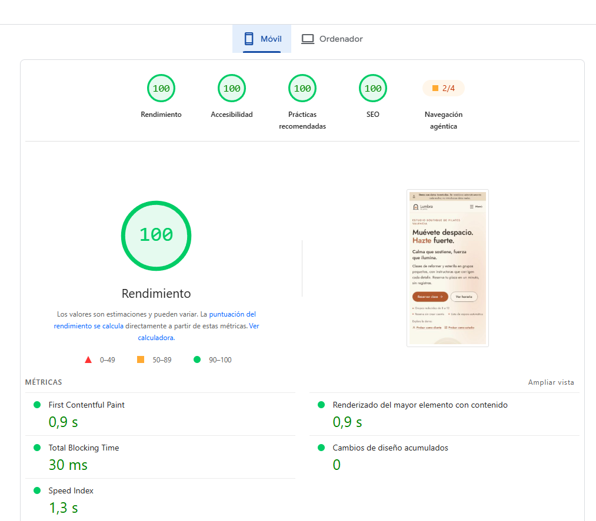 | 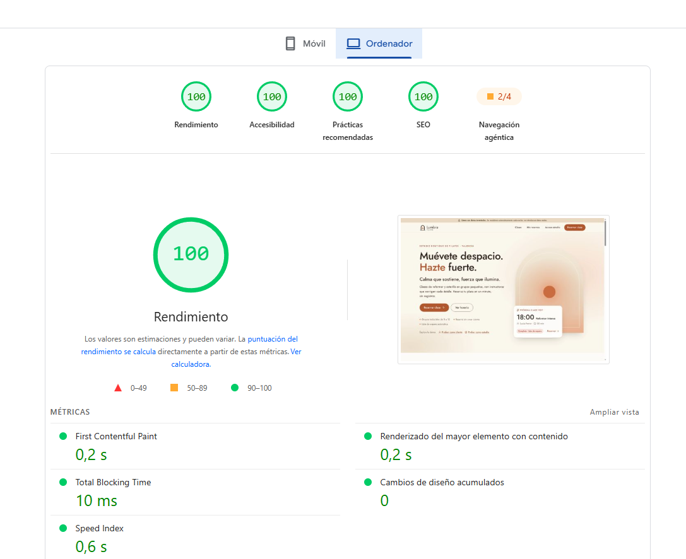 |

### Tamaño del build

Build de producción (gzip):

| Fragmento | Antes de la fase 5 | Después | Cuándo se descarga |
| --- | --- | --- | --- |
| `index-*.js` | 125,44 kB | 125,02 kB (123,72 kB con el logotipo en Jost) | Siempre |
| `supabaseJs-*.js` (supabase-js) | — | 55,16 kB | Solo al reservar, iniciar sesión o entrar en el panel |
| `StudioApp-*.js` | 12,51 kB | 12,14 kB | Solo en `/estudio` |
| Páginas legales | (en `index`) | 0,9 + 1,2 + 2,4 kB | Solo en `/privacidad` y `/aviso-legal` |

### Tipografía

Una sola familia, **Jost** variable (`@fontsource-variable/jost` 5.3.0), solo el subconjunto latino y un único woff2 que cubre los dos pesos usados: 500 en titulares, cifras grandes, botones, etiquetas y títulos de tarjeta (la palabra destacada se distingue solo por el color terracota-600), y 400 en los párrafos, en `tinta-800` (#3a2d26, contraste mínimo de 9,5:1 sobre los fondos de la paleta). Lleva `font-display: swap`, se precarga desde `index.html` y tiene un respaldo sobre Arial con `size-adjust` por peso para que el cambio de fuente no mueva el diseño.

| Fuentes | Archivos | Peso |
| --- | --- | --- |
| Antes: Fraunces 500 normal y cursiva, Figtree 400 y 600 | 4 woff2 | 63 816 B (62,3 KiB) |
| Ahora: Jost variable 400–500 | 1 woff2 | 26 576 B (26,0 KiB), un 58 % menos |

Los titulares llevan muy poco espaciado negativo (−0,01em en el display, −0,005em en `text-3xl`, nada en `text-2xl`), y el display llega como máximo a 4,25rem para que «Muévete despacio.» quepa en una línea en escritorio con Jost 500. El esqueleto de la tarjeta «Próxima clase» reserva el mismo alto que la tarjeta con datos.

CLS de la portada medido en Edge: 0 a 390 px y a 320 px con el texto al 200 %, y 0,0001 a 1280 px.

## Reglas de negocio

Las aplica la base de datos (`supabase/migrations`) con funciones de Postgres que comprueban las plazas de forma atómica. Replican las funciones puras con tests de `src/data/logic/`:

- Una reserva por email y clase; si la clase está llena, la reserva entra en lista de espera.
- Cancelación online hasta 2 horas antes; al liberar una plaza sube la primera persona de la lista.
- El estudio no puede bajar el aforo por debajo de las plazas reservadas; si lo sube, entra gente de la lista.
- Al cancelar una clase, sus reservas pasan a «cancelada por el estudio».
- Una sola sala: dos clases no pueden solaparse.
- La asistencia se marca desde 30 minutos antes de la clase.
- Mis reservas con código admite 5 intentos fallidos en 15 minutos por email.

## Backend y seguridad

El backend en Supabase (esquema, seguridad RLS, funciones de reserva, datos de ejemplo, cuentas demo y pruebas) está en [`supabase/`](supabase/README.md), con una guía paso a paso, la **guía de comprobación en Network** para la revisión humana (apartado 12), el resumen del **Security Advisor** (apartado 13) y los **resultados de la comprobación** de las pruebas SQL y de las 16 reglas desde el navegador (apartado 14).

## Cómo desplegarlo

La web es estática (Vite) y se publica en **Cloudflare Pages**. Los datos están en **Supabase**, y dos avisos externos evitan que el proyecto gratuito se pause.

### 1. Supabase

Sigue [`supabase/README.md`](supabase/README.md): ajustes del proyecto (apartado 3), migraciones `0001`–`0007` en el SQL Editor (apartado 4), `seed.sql`, cuentas demo (apartado 5), `cron.sql` (apartado 8) y `tests/seguridad_y_reglas.sql`. Copia la URL del proyecto y la clave **publishable** (Project Settings → API Keys). La clave secreta no se usa en ningún sitio.

### 2. Cloudflare Pages

**Workers & Pages → Create → Pages → Connect to Git**, con este repositorio:

| Ajuste | Valor |
| --- | --- |
| Project name | `lumbra-pilates` (da la URL `https://lumbra-pilates.pages.dev`) |
| Production branch | `main` |
| Framework preset | El de Vite o React (Vite) si aparece; si no, `None`. Lo que cuenta son las dos filas siguientes |
| Build command | `npm run build` |
| Build output directory | `dist` |
| Variables de entorno (Production y Preview) | `VITE_SUPABASE_URL` y `VITE_SUPABASE_PUBLISHABLE_KEY` |

Cada push a `main` publica la web, y cada rama tiene su vista previa. El build **falla a propósito** si falta `VITE_SUPABASE_URL` o si su origen no está en la CSP de `public/_headers`, para no publicar una web sin datos.

### 3. Rutas, cabeceras y dominio

- **`public/_redirects`** (`/* /index.html 200`): cualquier ruta devuelve la app, así que `/clases` o `/estudio/resumen` funcionan al recargar. Las rutas que no existen muestran la página 404 de la app, que lleva `noindex` (con estado HTTP 200, porque Cloudflare no permite reescribir con 404).
- **`public/_headers`**, en todas las rutas:

  | Cabecera | Valor y motivo |
  | --- | --- |
  | `Content-Security-Policy` | `default-src`, `script-src`, `style-src`, `img-src` y `font-src` solo `'self'`, **sin `unsafe-inline` ni `unsafe-eval`** (el `index.html` del build no tiene scripts en línea). `connect-src 'self'` más el proyecto de Supabase. `object-src 'none'`, `base-uri 'self'`, `form-action 'self'`, `frame-ancestors 'none'` (nadie puede meter la web en un iframe) y `upgrade-insecure-requests` |
  | `X-Content-Type-Options` | `nosniff`: el navegador no «adivina» el tipo de los archivos |
  | `Referrer-Policy` | `strict-origin-when-cross-origin`: Supabase solo ve el origen, no la ruta |
  | `Permissions-Policy` | Cámara, micrófono, ubicación, pagos, USB y Topics apagados |
  | `Strict-Transport-Security` | `max-age=31536000; includeSubDomains`: siempre https |
  | `Cross-Origin-Opener-Policy` | `same-origin`: la ventana queda aislada |

  `/assets/*` lleva `Cache-Control: public, max-age=31536000, immutable`, porque sus nombres llevan hash. El HTML no se guarda en caché. Los `noindex` de `/sistema`, `/mis-reservas` y `/estudio` siguen igual. Los tests `src/app/deploy.test.ts` e `indexing.test.ts` comprueban todas estas reglas.
- **Otro proyecto de Supabase:** cambia `VITE_SUPABASE_URL` en Cloudflare y el `connect-src` de `public/_headers`. El build avisa si no coinciden.
- **Otro dominio:** cambia solo `SITE_URL` en `src/lib/site.ts`. De ella salen el canonical y `og:url` (en `index.html`, con `%SITE_URL%`, y en cada página) y `robots.txt` y `sitemap.xml`, que genera un plugin de `vite.config.ts`. Un test comprueba que el dominio no aparece en ningún otro archivo.

### 4. Avisos para que Supabase no se pause

En el plan Free, Supabase pausa el proyecto tras una semana sin actividad. Dos servicios externos llaman a `health_check` (`POST /rest/v1/rpc/health_check` con la clave publishable) dos veces al día. Si la respuesta no es `{"ok": true}`, fallan:

| Aviso | Cuándo (UTC) | Archivo | Configuración |
| --- | --- | --- | --- |
| GitHub Actions | 07:17 y 19:17, y a mano | [`.github/workflows/keepalive.yml`](.github/workflows/keepalive.yml) | Secrets del repositorio `SUPABASE_URL` y `SUPABASE_PUBLISHABLE_KEY`. `permissions: {}` |
| Cloudflare Worker | 01:43 y 13:43 | [`keepalive-worker/`](keepalive-worker/README.md) | Paso a paso desde el panel, sin instalar nada |

> **GitHub desactiva los workflows programados de los repositorios públicos tras 60 días sin actividad en el repositorio.** Si pasan dos meses sin commits, el aviso de GitHub se para y solo queda el del Worker. Para reactivarlo: **Actions → keepalive → Enable workflow**.

## Calidad y verificación

Comprobado el 4 de noviembre de 2026 (fase 6), antes de publicar, y el 5 de noviembre contra la web publicada (fase 7, apartado «En producción»).

### Tests

272 tests con Vitest y Testing Library, todos en verde, sin herramientas añadidas a `package.json`:

| Módulo | Tests | Qué cubren |
| --- | --- | --- |
| Lógica de reservas, sesiones, validación y códigos (`src/data/logic`) | 61 | Reservar, lista de espera, duplicados, cancelar hasta 2 h antes, subida de la lista, crear y editar clases (aforo, solapes, pasado), cancelar clases, asistencia, validación de nombre, email y teléfono, códigos `LUM-XXXX`, horario y métricas |
| Capa Supabase (`src/data/supabase`) | 62 | Lo público va con `fetch`, solo con `apikey`, sin `Authorization` y sin descargar supabase-js; errores traducidos (red, límite de intentos, sesión caducada, servidor caído…); **sin sesión, o con la sesión caducada, ninguna de las 10 funciones de cuenta llega a llamarse**; sesión en la clave única; cierre de sesión `local` |
| RequireStudio y rutas del panel | 17 | Las 5 rutas del panel, sin sesión y con cliente, sin pedir datos del estudio; error al comprobar la sesión con «Reintentar»; acceso, contraseña incorrecta y cierre de sesión |
| Formulario de reserva | 9 | Validación en vivo, confirmación con código, lista de espera, menos de 2 h, cuenta demo, sin conexión sin perder lo escrito, clase que no carga o no existe |
| Mis reservas | 13 | Consulta, demasiados intentos, sin conexión, cancelar y subir la lista, salir de la lista de espera, error al cancelar, cuenta de cliente |
| Panel del estudio | 21 | Resumen (métricas, vacío, error, franjas «07–09 h», listas de espera con enlace a Asistentes, sin esperas y error con «Reintentar»), Clases (crear, cerrar con Esc, aforo por debajo de las reservas, error del servidor, cancelar clase), Asistentes (abrir clase, asistencia, reserva manual, subida de la lista, errores) y el formulario de clase |
| Demo en memoria y datos de ejemplo | 36 | Persistencia en la clave única, semilla coherente en distintas fechas |
| Componentes y utilidades | 35 | Diálogos con foco atrapado, menú de acciones con teclado, tarjetas de clase, pestañas de día, fechas en hora de Madrid, archivo `.ics`, refresco de datos y páginas legales |
| Publicación (`src/app/deploy.test.ts`, `indexing.test.ts`, `StaticShell.test.tsx`) | 13 | `_redirects`, CSP sin `unsafe-*` y con un solo proyecto de Supabase, cabeceras de seguridad, caché solo en `/assets/*`, límites de Cloudflare, sitemap, robots, `noindex`, el dominio escrito solo en `SITE_URL` y el shell estático (delante de `#root`, una sola vez y sin que React lo repita) |
| Aviso de Cloudflare (`keepalive-worker`) | 5 | Llamada a `health_check` solo con `apikey`, fallos si no responde ok, error HTTP o faltan variables, 404 desde fuera |

Las pruebas SQL del backend (`supabase/tests/seguridad_y_reglas.sql`) y las reglas comprobadas desde el navegador están en [`supabase/README.md`](supabase/README.md), apartado 14.

### Accesibilidad

- **axe-core 4.10** (WCAG 2.0, 2.1 y 2.2 A y AA, y buenas prácticas) en 21 pantallas a 390 y a 1280 px: portada, horario, detalle de clase, formulario con errores, confirmación, lista de espera, Mis reservas (vacío, resultado y con cuenta), privacidad, aviso legal, sistema de diseño, 404, acceso, aviso «sin acceso», las cuatro pantallas del panel y sus formularios. **0 incidencias.** Al empezar había dos, ya corregidas: la lista de horario del pie y del menú (cada grupo de la `<dl>` llevaba un icono fuera de `<dt>` y `<dd>`) y el contraste de los números de las tarjetas de clase.
- **Teclado:** el primer foco es «Saltar al contenido», que lleva a `#contenido`. Todas las paradas tienen el foco visible y ninguna está oculta. El orden sigue la lectura; solo «sube» al pasar a la siguiente columna (días del horario, columnas del pie y del panel). Escape cierra los seis diálogos (detalle, menú móvil, cancelar en Mis reservas y en el panel, añadir reserva, nueva clase) y devuelve el foco al botón que lo abrió.
- **Nombres accesibles:** ningún campo, botón de icono ni enlace sin nombre. Las pestañas de día empiezan por lo que se ve («Lun 2, 5 clases: lunes 2 de noviembre»), para el control por voz (WCAG 2.5.3).
- **`prefers-reduced-motion: reduce`:** ninguna animación ni transición dura más de 0 y el desplazamiento no es suave.
- **Consola:** sin errores ni avisos en todo el recorrido.

### Estados de cada pantalla

Los 37 casos comprobados con Playwright (carga, vacío, error y sin conexión en la portada, el horario, el detalle, Mis reservas con código y con cuenta, y las cuatro pantallas del panel) muestran su estado diseñado. Sin conexión, lo que ya se veía se mantiene, lo nuevo avisa con «Reintentar» y el formulario de reserva conserva lo escrito. Al volver la conexión, «Reintentar» carga los datos.

| | | |
| --- | --- | --- |
| 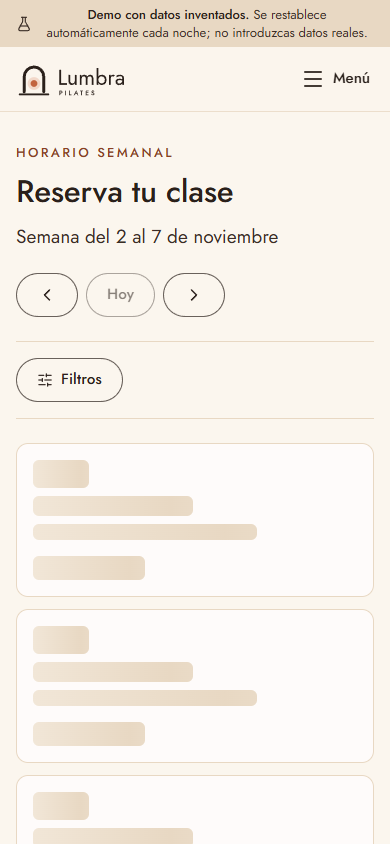 Cargando | 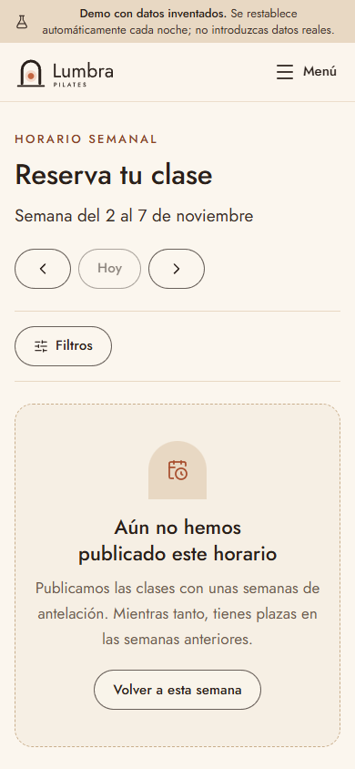 Vacío | 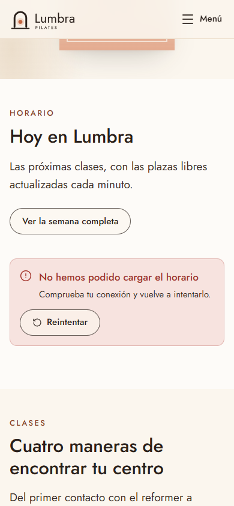 Error |
| 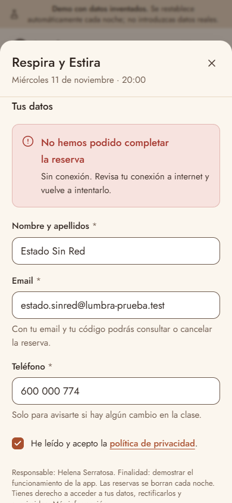 Sin conexión | 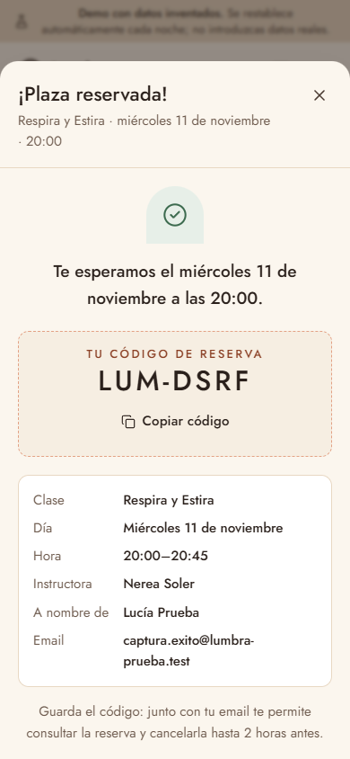 Éxito | 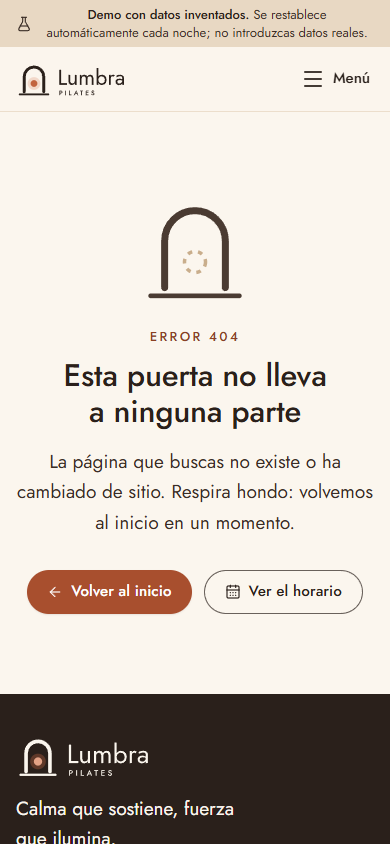 404 |
| 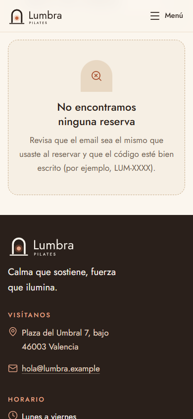 Reserva no encontrada | 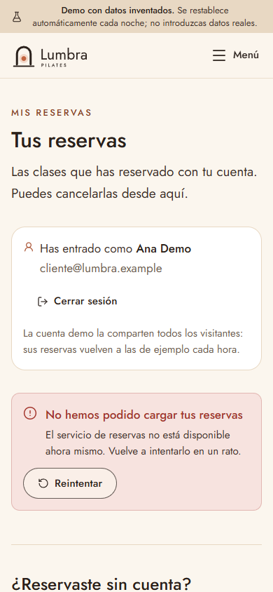 Servicio no disponible | |

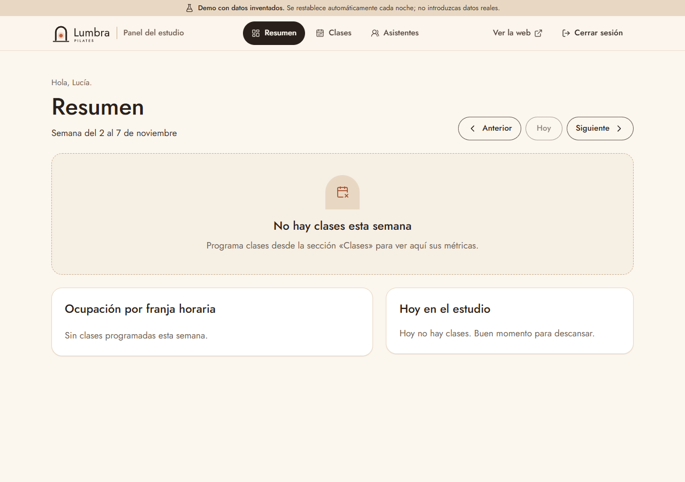
*Panel: semana sin clases.*

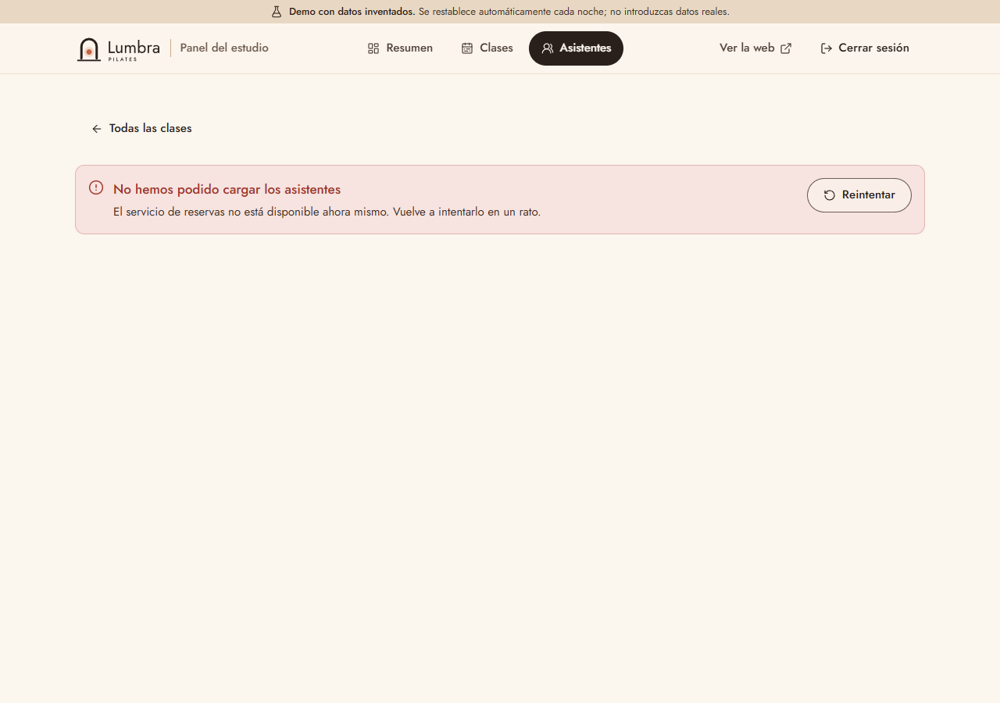
*Panel: error al cargar los asistentes, con el camino de vuelta.*

### Fugas invisibles

- **npm audit:** 0 vulnerabilidades, tanto con todas las dependencias como solo con las de producción.
- **gitleaks 8.30.1** (binario oficial de la release de GitHub, con el SHA256 comprobado contra `gitleaks_8.30.1_checksums.txt`) sobre todo el historial de `main`, la única rama: **0 hallazgos** en 29 commits en la fase 6 y otra vez en los 39 de la fase 7, antes de hacer público el repositorio. `.env.local` no aparece en ningún commit y está en `.gitignore`.
- **Qué no se sube:** `.env.local`, `CLAUDE.md`, `.claude/`, `dist/` y `node_modules/` están en `.gitignore`. No hay archivos de prueba ni de soporte en la raíz, y las herramientas de verificación (Playwright, gitleaks) viven fuera del proyecto. Los commits llevan el email `noreply` de GitHub.
- **Clave secreta en la web:** en los JS del build, `sb_secret_` solo aparece dentro de supabase-js, como prefijo que la librería comprueba; `service_role` y `eyJ` no aparecen.

### En producción (fase 7)

Comprobado el 5 de noviembre de 2026 contra https://lumbra-pilates.pages.dev.

**Cabeceras reales** (`curl -I`). Las seis de seguridad llegan en todas las rutas, sin duplicados: CSP (con `frame-ancestors 'none'`), `Strict-Transport-Security: max-age=31536000; includeSubDomains`, `X-Content-Type-Options: nosniff`, `Referrer-Policy: strict-origin-when-cross-origin`, `Permissions-Policy` y `Cross-Origin-Opener-Policy: same-origin`. Cloudflare Pages añade por su cuenta `Access-Control-Allow-Origin: *`.

| Ruta | Estado | Seguridad (6) | `X-Robots-Tag` | `Cache-Control` | `Content-Type` |
| --- | --- | --- | --- | --- | --- |
| `/` | 200 | Sí | — | `public, max-age=0, must-revalidate` | `text/html` |
| `/clases` | 200 | Sí | — | `max-age=0` | `text/html` |
| `/mis-reservas` | 200 | Sí | `noindex` | `max-age=0` | `text/html` |
| `/sistema` | 200 | Sí | `noindex` | `max-age=0` | `text/html` |
| `/estudio/resumen` | 200 | Sí | `noindex` | `max-age=0` | `text/html` |
| `/no-existe` | 200 ² | Sí | — ² | `max-age=0` | `text/html` |
| `/robots.txt` | 200 | Sí | — | `max-age=0` | `text/plain` |
| `/sitemap.xml` | 200 | Sí | — | `max-age=0` | `application/xml` |
| `/assets/index-*.js` | 200 | Sí | — | `public, max-age=31536000, immutable` | `application/javascript` |

² La app muestra su 404 y pone `noindex` en la página; Cloudflare no permite reescribir con estado 404.

**Rutas.** `/clases`, `/mis-reservas` y `/estudio/resumen` cargadas directamente dan 200 con la app, así que la regla de `_redirects` funciona. `robots.txt` apunta a `https://lumbra-pilates.pages.dev/sitemap.xml`, y el sitemap lista `/`, `/clases`, `/privacidad` y `/aviso-legal` con esa URL.

**Recorrido en Edge** (una tanda a 1280 px y otra a 390 px, un inicio de sesión por cuenta demo y tanda, sin congelar la hora): portada, horario, detalle, reserva sin sesión, Mis reservas con su código y cancelación, cliente demo y estudio demo. **Ninguna violación de la CSP**, la consola sin errores ni avisos y supabase-js sin descargar en la portada. Las reservas de prueba usan emails `@lumbra-prueba.test` y quedaron canceladas.

**Reglas de la guía de Network** ([`supabase/README.md`](supabase/README.md), apartado 12), repetidas contra producción sin sacar ningún token del navegador:

| # | Regla | Resultado |
| --- | --- | --- |
| 3 | Sin sesión no se leen reservas | `GET bookings?select=*` y `?select=email,phone`: `401 permission denied` |
| 15 | El registro está cerrado | `POST auth/v1/signup`: `422 Signups not allowed` |
| 10 | `/estudio/resumen` sin permiso | Sin sesión, el acceso; con el cliente, «Esta cuenta no tiene acceso». **Ninguna petición del estudio** en los dos casos |
| 11 | Las funciones del estudio exigen ser miembro | `get_roster`: sin sesión, `401`; con el cliente, `400 unauthorized` |
| 7 | El cliente solo ve lo suyo | Mis reservas y `GET bookings`: solo sus 4 filas (un único `user_id`, todas con su email); con `user_id=neq.<su id>`, `[]` |
| 13 | El estudio ve enmascarados los datos de los visitantes | En `get_roster`, la reserva de prueba sale como `***@lumbra-prueba.test`, con el teléfono enmascarado |

**Claves en los JS publicados.** Los 6 archivos JS (`index`, `StudioApp`, `supabaseJs` y las tres páginas legales): `sb_secret_` seguido de caracteres, **0**; `service_role`, **0**; `eyJ`, **0**. El prefijo `sb_secret_` aparece una vez, en supabase-js, sin nada detrás (`startsWith('sb_secret_')`).

**Avisos para que Supabase no se pause.** Los dos responden: el workflow de GitHub Actions y el Worker `lumbra-keepalive`, que se ejecutó con su Cron Trigger el 5 de noviembre a las 13:43 UTC y respondió `health_check ok`, sin errores.

## Scripts

| Comando | Qué hace |
| --- | --- |
| `npm run dev` | Servidor de desarrollo en http://localhost:5176 |
| `npm run build` | Compilación de producción |
| `npm run preview` | Sirve la compilación en el puerto 5176 (con el servidor de desarrollo abierto: `npx vite preview --port 4176 --strictPort`) |
| `npm run lint` | Lint con oxlint |
| `npm run typecheck` | Comprobación de tipos |
| `npm run test` | Tests con Vitest |
